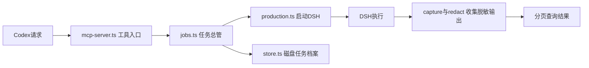

# MCP 桥中文阅读指南

本仓库基于已验收的R4源码，包含中文注释。冻结基线、运行部署和完整审计档案由作者在本地保留，未随本仓库公开。

21个核心TypeScript文件补充了349段中文说明，包括模块导读、函数用途、重要字段和关键流程。原有英文注释保留，便于对照技术细节。

## 先理解它的工作

把桥看作任务管理员：Codex交来任务，管理员核对允许的项目和时限，保存任务副本，再启动DSH。Codex随后查询进度、读取结果或请求停止。

桥记录执行和输出事实，例如进程退出、日志字节是否完整；它不替人判断游戏功能是否正确，业务验收仍由Codex完成。

## 推荐阅读顺序

| 顺序 | 文件 | 先看懂的问题 |
| --- | --- | --- |
| 1 | [src/index.ts](src/index.ts) | 程序怎样启动、连接和关闭？ |
| 2 | [src/mcp-server.ts](src/mcp-server.ts) | 五个工具各做什么？ |
| 3 | [src/jobs.ts](src/jobs.ts) | 任务如何从提交到结束？先找到submit，再搜索“受理步骤”。 |
| 4 | [src/types.ts](src/types.ts) | 状态名和任务档案字段是什么意思？ |
| 5 | [src/store.ts](src/store.ts) | 记录保存在哪里，为什么不会随便重复执行？ |
| 6 | [src/runners/production.ts](src/runners/production.ts) | 哪个方法真正启动DSH？ |
| 7 | [src/capture.ts](src/capture.ts)、[src/redact.ts](src/redact.ts) | 输出怎样脱敏、限制大小和分页？ |
| 8 | [src/config.ts](src/config.ts)、[src/ownership.ts](src/ownership.ts) | 为什么只允许指定目录，怎样避免两个桥同时写记录？ |

其余模块遇到时再看：atomic可靠写文件，paths检查路径，hashing计算内容指纹，audit准备审计快照，proctree停止进程，process-identity检查身份，errors格式化错误，logging记录桥的诊断信息。runner定义共同接口，runners/shared负责公共启动步骤，runners/fake供本地测试。

## 常见代码符号

| 写法 | 普通话解释 |
| --- | --- |
| `const` / `let` | 给值起名字；const的名字不能重新赋值，let可以。const不意味着对象内部绝对不变。 |
| `function` / 方法 | 可重复调用的一段操作，括号里是输入。 |
| `class` | 把有关的数据和操作放在一起，例如JobManager是任务总管。 |
| `interface` / `type` | 数据格式说明，帮助编译前发现传错参数；本身不执行任务。 |
| `async` / `await` | 操作可能需要等待；等待期间其他异步事件仍可能到达，并不是锁死整个程序。 |
| `Promise` | 稍后得到的结果，也可能失败。 |
| `try` / `catch` | 尝试操作，失败时进入错误处理；不代表自动重开模型任务。 |
| `throw` | 当前步骤无法继续，把错误交给上层。 |
| `#name` | 类内部的数据或方法，外部不能直接访问。 |
| `null` / `unknown` | null通常表示尚无值；unknown表示类型尚不可信，要先检查。具体含义看字段注释。 |
| `Map` / `Set` | 按键找值的表／不重复的集合。 |
| `Buffer` | 原始字节；中文或emoji通常占多个UTF-8字节。 |
| `fs` / `path` | Node.js的文件系统／路径工具。 |

## 阅读时记住这几条

- dsh_submit先返回jobId，DSH可能还在启动或运行。
- completed表示子进程退出码为0，仍需独立验收业务。
- 请求取消不代表停止已经获证。看status和cleanup的具体记录；停止根进程不保证自行脱离进程树的程序被找回。
- requestId是调用方的防重复请求编号，jobId是桥分配的作业编号。同requestId同内容会返回旧作业，换编号可能成为新执行。
- 结果正文在page.output，下一页从nextOffset继续。totalChars按Unicode码点计算，不能拿字符串length当作同一单位。
- truncated=true说明丢弃过输出；读完保留部分也不代表原始输出完整。

## 源码与运行版本

你主要阅读src里的.ts文件。dist里的.js是构建出来供Node.js运行的版本；只改src不会自动更新运行中的桥。

这份阅读版没有复制依赖目录、测试临时目录、真实状态或构建产物。后续打包要按锁文件恢复依赖并构建，确认发布入口。

已有reports清单和历史验收文档对应原R4基线。注释版的文件差异和等价核验记录在项目根的 `audits/documentation/2026-10-11`，没有覆盖旧冻结证据。
